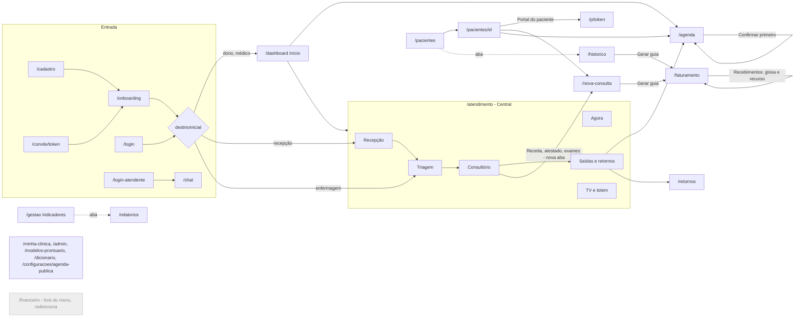
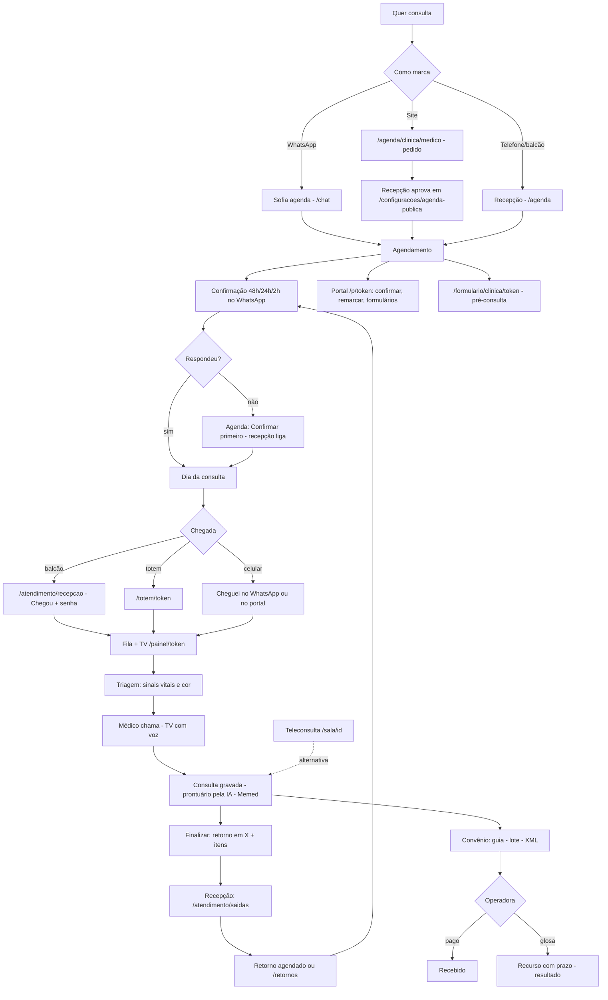

# Mapa de UX do Clinical 360 (como está hoje)

Branch `redesign-v2`, 20/10/2026, depois do commit `950cf0e` (portal do paciente). Fiz só a leitura do código, sem mudar nenhuma tela.
Objetivo do Lucas: **"uma plataforma completa e fácil de usar"**.

Fontes: `FUNCOES-CLINICAL360.md`, `components/Sidebar.tsx`, `components/BottomNav.tsx`, `components/Topbar.tsx`,
`app/atendimento/layout.tsx`, `next.config.js`, `lib/destino.ts`, `lib/cargos.ts`, `lib/planos.ts`, `components/shell/TourGuiado.tsx` e as telas em `app/**/page.tsx`.

---

## 0. Inventário de telas (resumo)

| Área | Rota | Quem usa | Como chega |
|---|---|---|---|
| Entrada | `/cadastro` (3 passos: perfil, dados, senha) → `/onboarding` | Dono, autônomo | Site `/` |
| Entrada | `/login`, `/login-atendente`, `/forgot-password`, `/reset-password`, `/verificar-email`, `/trocar-senha-obrigatoria`, `/convite/[token]` | Todos | Link, email, convite |
| Início | `/dashboard` (KPIs, confirmações 48h, próximos, CIDs, convênios, PDF mensal) | Dono, médico (recepção e enfermagem são **redirecionadas**) | Menu "Início" |
| Agenda | `/agenda` (dia, semana e mês, encaixe, bloqueio, lista de espera, **"Confirmar primeiro"**) | Todos menos atendente | Menu |
| Central | `/atendimento` → abre no "meu posto"; abas `agora`, `recepcao`, `triagem`, `consultorio`, `saidas`, `telas` | Por perfil (layout:21-28) | Menu "Central", "Meu consultório" e "Triagem" |
| Mensagens | `/chat` (conversas e quadro; WhatsApp, Instagram, Messenger) | Dono, médico, recepção, atendente | Menu |
| Pacientes | `/pacientes` + aba `/historico` ("Consultas e prontuários", só para quem atende), `/pacientes/[id]` (ficha completa, **Portal do paciente**), ficha rápida (gaveta global) | Todos | Menu, busca ⌘K |
| Pacientes | `/retornos` (Retornos, Reativação, Campanhas) | Dono, médico, recepção | Menu |
| Pacientes | `/formularios`, `/formularios/[id]`, `/formularios/respostas/[envioId]` | Dono, médico, recepção | Menu |
| Consulta | `/nova-consulta`, `/teleconsulta` → `/sala/[id]`, `/exames`, `/ditado`, `/assistente-ia` (botão do topo) | Médico e dono | Menu "Consulta e IA" |
| Gestão | `/gestao` ("Atendimento do dia") + aba `/relatorios` (Visão geral, **Por médico com receita**, Faltas, Ocupação, Convênios) | Gestor; o médico vê "Meus números" | Menu |
| Convênios | `/faturamento` (Guias, Lotes, **Recebimentos com recurso de glosa**, Operadoras) | Todos menos enfermagem | Menu "Convênios (TISS)" |
| Ajustes | `/minha-clinica` (Visão geral, Unidades, Recepção e painel, Canais, Procedimentos, Sofia, Automações, Privacidade e LGPD), `/admin` (Equipe, atendentes do chat) | Gestor | Menu e menu da conta |
| Ajustes | `/modelos-prontuario`, `/dicionario`, `/configuracoes/agenda-publica` | Quem atende | Menu "Configurações" |
| Conta | `/perfil`, `/planos`, `/notificacoes`, `/lgpd` | Todos | Menu da conta, sino, Perfil |
| Paciente (links públicos) | `/agenda/[medico]` ou `/agenda/[clinica]/[medico]`, `/formulario/[clinica]/[token]`, **`/p/[token]`**, `/sala/[sala_id]`, `/totem/[token]`, `/painel/[token]` (TV) | Paciente | Link da clínica ou tela física |
| Fora do menu (de propósito) | `/financeiro/*` (14 telas) e `/comandas/[id]`: **hoje redirecionam para `/dashboard`** (`app/financeiro/page.tsx:6`) | Ninguém | Não religar agora |
| Redirecionamentos | `/recepcao`, `/triagem`, `/consultorio` → `/atendimento/*` (`next.config.js:45-47`); `/clinica`, `/configuracoes`, `/configuracoes/sofia`, `/configurar-chat`, `/automacoes`, `/procedimentos` → `/minha-clinica?aba=…`; `/whatsapp-app`, `/contatos` → `/chat`; `/insights` e `/cadastro-sucesso` → Início/login | | Links antigos |
| Interno | `/superadmin`, `/dev-login` | Equipe Clinical 360 | |

---

## 1. Mapa por perfil

Regras: `lib/cargos.ts` (o helper `ehApoio` junta recepção e enfermagem), `lib/atendimento/posto.ts` (perfil e posto) e `lib/destino.ts` (onde cada um cai depois de entrar).

### 1.1 Dono / gestor (`clinica_admins`) e médico-administrador (`cargo = admin`)
- **Cai em:** `/dashboard`.
- **Menu (Sidebar.tsx:60-104):**
  - Início: Início, Agenda.
  - Atendimento: Central de atendimento e Chat. O médico-admin também vê "Meu consultório".
  - Pacientes: Pacientes, Retornos, Formulários.
  - Consulta e IA: Nova consulta, Teleconsulta, Analisar exames, Ditado.
  - Gestão: Indicadores e Convênios (TISS).
  - Configurações: Minha clínica, Equipe, Modelos, Dicionário, Agenda online, Meu perfil.
- **Celular (BottomNav.tsx:51-55):** Início, Atendimento, Agenda, Pacientes e Mais.
- **Central:** todas as abas (Agora, Recepção, Triagem, Consultório, Saídas, TV e totem).
- **Ações principais:**
  - Acompanhar o dia em Agora e Indicadores.
  - Configurar a clínica, a equipe e os canais.
  - Ver a receita por médico em Relatórios → Por médico.
  - Faturar convênios e cuidar das glosas.
  - Exportar CSV e o PDF mensal.
- **Atenção:** o dono que não é médico também vê "Consulta e IA", "Modelos" e "Dicionário", porque `naoRecep` vale `true` para ele (Sidebar.tsx:81, 97).

### 1.2 Médico (`cargo = medico`)
- **Cai em:** `/dashboard`.
- **Menu:**
  - Início e Agenda.
  - Meu consultório, Central e Chat.
  - Pacientes, Retornos e Formulários.
  - Consulta e IA.
  - Meus números (`/relatorios`) e Convênios.
  - Modelos, Dicionário, Agenda online e Meu perfil.
- **Celular:** Consultório, Agenda, Pacientes, Nova consulta e Mais.
- **Central:** Agora, Triagem, Consultório e Saídas.
- **Ações principais:**
  - Chamar o próximo (TV com voz).
  - Iniciar a consulta e gravar; a IA escreve o prontuário.
  - "Receita, atestado e exames" (abre `/nova-consulta` em outra aba).
  - Finalizar com "retorno em X" e itens para a recepção.
  - Ver os próprios números.

### 1.3 Recepção (`cargo = recepcionista`)
- **Cai em:** `/atendimento/recepcao`. "Início" redireciona para lá (`app/dashboard/page.tsx:132`).
- **Menu:**
  - Início e Agenda.
  - Central e Chat.
  - Pacientes, Retornos e Formulários.
  - Convênios.
  - Meu perfil.
- **Celular:** Atendimento, Agenda, Chat, Pacientes e Mais. Em "Mais" ainda aparecem Faturamento e Agenda online.
- **Central:** Agora, Recepção, Triagem, Saídas e TV e totem.
- **Ações principais:**
  - Check-in com "Chegou" e senha normal ou prioritária; "Não veio".
  - Novo atendimento (tecla N).
  - Chamar a senha do balcão e publicar recado na TV.
  - Resolver as saídas do consultório e agendar o retorno.
  - Faturar guias.
- **Problema grave (P0, ver A1):** pelo código, a Agenda e a lista de Pacientes da recepção carregam pelo **id da própria recepcionista**, então devem abrir vazias.

### 1.4 Enfermagem (`cargo = enfermagem`)
- **Cai em:** `/atendimento/triagem`.
- **Menu:** Início (redireciona para a Triagem), Agenda, Triagem, Central, Pacientes e Meu perfil.
- **Celular:** usa a **barra da recepção** (Atendimento, Agenda, **Chat**, Pacientes), porque `ehApoio` trata as duas iguais (BottomNav.tsx:39, 46-50).
- **Central:** Agora e Triagem.
- **Ações principais:**
  - Chamar o próximo da triagem.
  - Registrar queixa e sinais vitais e ver a cor sugerida com o motivo.
  - Mandar para a fila do médico.
  - Marcar "Não apareceu".

### 1.5 Atendente de chat (`/login-atendente`)
- Vê só `/chat`, no menu e na barra do celular. Se tentar abrir `/atendimento`, volta para `/chat` (`app/atendimento/layout.tsx:42`). Está correto.

### 1.6 Autônomo no plano Grátis
- **Cadastro:** perfil "autônomo" → entra como **médico-administrador** → onboarding com a jornada do autônomo → `/dashboard`.
- **Menu:** o de gestor e médico juntos, mas com **cadeado** em Meu consultório, Central, Indicadores, Analisar exames, Convênios e Equipe (`lib/planos.ts:21,50-55`; Sidebar.tsx:275). São 6 cadeados.
- **Celular:** o primeiro botão é "Consultório", que está **bloqueado** (BottomNav.tsx:56-57).
- **O que usa:**
  - Agenda e Pacientes.
  - Nova consulta: 10 consultas com IA por mês.
  - Teleconsulta e Memed.
  - Chat do WhatsApp, sem a Sofia.
  - Agenda online.
- Relatórios fica sem caminho no menu, porque só abre como aba de Indicadores, que está bloqueado.

### 1.7 Paciente (links públicos, sem login)

| Link | De onde vem | O que faz |
|---|---|---|
| `/agenda/[medico]` ou `/agenda/[clinica]/[medico]` | Site, Instagram, Sofia | Pede um horário. O pedido cai em `/configuracoes/agenda-publica` para aprovar ou rejeitar |
| `/formulario/[clinica]/[token]` | Enviado da ficha ("Enviar formulário"), do agendamento ou da agenda online | Anamnese e consentimento; a IA resume as respostas |
| **`/p/[token]`** (portal) | Botão "Portal do paciente" na **ficha completa** → copiar ou abrir o `wa.me` (`components/BotaoPortalPaciente.tsx`) | Próxima consulta: confirmar, pedir para remarcar, "Cheguei" (gera a senha), entrar na teleconsulta, formulários, retorno previsto, WhatsApp e telefone da clínica |
| `/sala/[sala_id]` | Teleconsulta (`/teleconsulta`, agenda) | Vídeo com o médico |
| `/totem/[token]` | Tablet na entrada (Central → TV e totem) | Retira a senha |
| `/painel/[token]` | TV da sala de espera | Vê a chamada da senha (voz), recados, nunca o tempo de espera |
| WhatsApp | Sofia, confirmação 48h/24h/2h, "cheguei", NPS, adesão | Conversa; a recepção vê no `/chat` |

---

## 2. Jornadas de ponta a ponta

### 2.1 Criar conta e configurar (dono de clínica)
1. Site → **Criar conta**: `/cadastro`, passo 1, escolher "Clínica" (ou "Autônomo" ou "Rede").
2. Dados: nome, email, telefone e nome da clínica (`/cadastro`, passo 2).
3. Senha e aceite dos termos → conta criada (`/cadastro`, passo 3).
4. Onboarding: boas-vindas, dados da clínica, "como funciona" (jornada do paciente), objetivos e equipe (`/onboarding`).
5. Tour guiado em balões, que termina em "Por onde começar" (`/dashboard?tour=1`, `TourGuiado.tsx`).
6. Montar a recepção (salas, consultórios, voz, totem e triagem): `/minha-clinica?aba=atendimento`.
7. Convidar a equipe por link: `/admin?add=medico` → a pessoa abre `/convite/[token]` → `/onboarding` dela.
8. Conectar o WhatsApp: `/minha-clinica?aba=canais`. Depois ensinar a Sofia (`?aba=sofia`) e ligar as automações de confirmação (`?aba=automacoes`).
9. Cadastrar procedimentos com valor e duração: `/minha-clinica?aba=procedimentos`. A receita por médico depende disso.
10. Cadastrar operadoras e tabela de preços: `/faturamento` → Operadoras.
11. Publicar a agenda online: `/configuracoes/agenda-publica` → link `/agenda/[clinica]/[medico]`.
12. Abrir a TV e o totem: `/atendimento/telas` → "Abrir TV" `/painel/[token]` e "Abrir totem" `/totem/[token]`.

> Atrito: depois que o tour fecha, não sobra nenhuma lista de "o que falta". `SetupChecklist.tsx` existe, mas não é usado em nenhuma tela (A16).

### 2.2 Primeiro paciente
1. Importar a base por planilha (`/pacientes` → Importar) ou cadastrar na hora (`/pacientes` → Novo).
2. Abrir a ficha: `/pacientes/[id]` (ou a ficha rápida pela busca ⌘K).
3. Agendar pela ficha ("Agendar") ou pela `/agenda?novo=1&paciente_id=…`.
4. Mandar o formulário de pré-consulta: ficha → "Enviar formulário" → paciente em `/formulario/[clinica]/[token]`.
5. Mandar o portal: ficha → "Portal do paciente" → copiar ou `wa.me` → paciente em `/p/[token]`.

### 2.3 Dia típico da clínica
1. **Agendar:**
   - Recepção em `/agenda`.
   - Sofia no WhatsApp; a conversa aparece em `/chat`.
   - Paciente pela agenda online `/agenda/[clinica]/[medico]`; o pedido é aprovado em `/configuracoes/agenda-publica` (também tem atalho em `/atendimento/saidas`).
2. **Confirmar:**
   - Automação pelo WhatsApp 48h, 24h e 2h antes.
   - Card "Confirmações" no `/dashboard`.
   - **Botão "Confirmar primeiro"** na `/agenda`: próximos 3 dias, sem confirmação, do maior risco para o menor, com o motivo escrito.
   - Pelo portal `/p/[token]` → "Confirmar".
   - O pedido de remarcar pelo portal chega no sino com link `/agenda?ag=…`.
3. **Chegar:**
   - "Chegou" em `/atendimento/recepcao`: confere os dados e gera a senha.
   - Ou pelo totem `/totem/[token]`, pelo "cheguei" no WhatsApp ou por "Cheguei" no portal `/p/[token]`.
   - A senha aparece na TV `/painel/[token]`.
4. **Triagem:** `/atendimento/triagem`. Chamar o próximo (TV), registrar sinais vitais, escolher a cor e "Enviar para o médico". A fila do médico passa a ordenar pela gravidade.
5. **Consulta com IA:** `/atendimento/consultorio`.
   1. Chamar o próximo (só o médico chama).
   2. Iniciar a consulta: grava e a IA escreve o prontuário.
   3. Clicar em "Receita, atestado e exames", que abre `/nova-consulta?paciente_id=…` em **outra aba** para usar a Memed e os documentos.
   4. Paciente sem senha (encaixe ou telefone): botão "Consulta sem senha" → `/nova-consulta`.
6. **Saída e retorno:**
   - O médico clica em "Finalizar atendimento" e escolhe o retorno (chips de prazo), os itens para a recepção e um recado.
   - A recepção recebe um aviso ao vivo e no sino, e a pendência aparece em `/atendimento/saidas`.
   - A recepção agenda em `/agenda?novo=1&paciente_id=…&tipo=retorno&data=…`.
   - Os retornos vencidos ficam em `/retornos`.
7. **Convênio:**
   1. `/faturamento` → Guias → "Consultas de convênio sem guia" → "Gerar todas". Também dá para gerar em `/historico` ou no fim de `/nova-consulta`.
   2. Lotes → XML TISS 4.01 → enviar no portal da operadora.
   3. Recebimentos → informar o retorno (pago, pago em parte ou glosado).

### 2.4 Fim do mês
1. Números do mês: `/dashboard` (período "Este mês" e botão "Relatório mensal" em PDF).
2. Indicadores do atendimento (espera, faltas, picos, por médico): `/gestao`, período de 30 dias.
3. Relatórios: `/relatorios`.
   - **Por médico** traz a receita estimada pela tabela de procedimentos.
   - Também tem as abas Faltas, Ocupação e Convênios, com exportação em CSV.
4. Glosas: `/faturamento` → Recebimentos.
   1. Usar o filtro "Glosas" e abrir o **recurso** (prazo, justificativa sugerida pelo motivo, protocolo).
   2. Acompanhar no filtro "Em recurso" e registrar o resultado (aceito, em parte ou negado).
   3. Se preferir, reapresentar o valor glosado como uma guia nova.
5. Reativação e campanhas: `/retornos` → Reativação ou Campanhas.
6. Auditoria e LGPD: `/minha-clinica?aba=lgpd`.

---

## 3. Diagramas

### 3.1 Navegação principal

### 3.2 Jornada do paciente

---

## 4. Atritos que ainda existem

Prioridade: **P0** atrapalha o uso diário, **P1** melhora clara, **P2** polimento. Esforço: **P** pequeno, **M** médio, **G** grande.

### P0
| # | Atrito | Onde | Esforço |
|---|---|---|---|
| A1 | **A recepção (e a enfermagem) deve ver a Agenda e os Pacientes vazios.** As duas telas só tratam `clinica_admin` como visão da clínica. Para os outros cargos, filtram pelo id de quem entrou, e a recepcionista não tem agendamentos nem pacientes próprios. O agendamento criado pela recepção também fica no id dela. Isso contraria o princípio "recepção vê tudo para agendar". `/retornos` já faz certo e serve de modelo (`app/retornos/page.tsx:51-53`). Confirmar com a conta de teste da recepção. | `app/agenda/page.tsx:403-416`, `427-429`, `715-726`; `app/pacientes/page.tsx:138-146`; `app/api/pacientes/route.ts:16-39` | P–M |
| A2 | **O médico-administrador some das listas da clínica.** Muitas consultas usam `.eq('cargo','medico')`. Um dono com sócio médico-admin não vê a agenda, os pacientes nem os números desse sócio. | `app/agenda/page.tsx:410`, `app/dashboard/page.tsx:125`, `app/api/pacientes/route.ts:22`, `app/retornos/page.tsx:50`, `app/historico/page.tsx:64,80`, `app/pacientes/[id]/page.tsx:74,170` | P |
| A3 | **Quando o dono que não é médico faz uma "Nova consulta", ela fica no nome do primeiro cadastro da clínica**, sem filtrar o cargo (pode ser uma recepcionista). Além disso, "Consulta e IA" aparece para ele no menu. | `app/nova-consulta/page.tsx:172-176`; `components/Sidebar.tsx:81` | P |
| A4 | **Os pedidos da agenda online (aprovar ou rejeitar) são trabalho do dia, mas ficam numa tela de Configurações.** A recepção não tem esse item no menu e só chega pelo card em Saídas. | `components/Sidebar.tsx:97-101`; `app/atendimento/saidas/page.tsx:25` | M |

### P1
| # | Atrito | Onde | Esforço |
|---|---|---|---|
| A5 | **A barra do celular não acompanhou o menu novo.** A enfermagem recebe a barra da recepção, com Chat. Os nomes são antigos ("Faturamento", "Histórico", "Relatórios", "Assistente IA"). Faltam Ditado e Dicionário, e a recepção vê Agenda online em "Mais". | `components/BottomNav.tsx:39-86` | P |
| A6 | **No onboarding e no tour, a enfermagem é tratada como recepção.** Ela recebe a jornada e o formulário da recepção, e ao concluir vai para a **Recepção** em vez da Triagem. O tour sugere "check-in e senhas". | `app/onboarding/page.tsx:110`, `128`, `136`, `197`; `components/shell/TourGuiado.tsx:66-70`, `96` | P |
| A7 | **O plano Grátis parece uma parede de cadeados.** São 6 itens bloqueados no menu, o 1º botão do celular está bloqueado e **Relatórios fica sem caminho**, porque só abre como aba de Indicadores (`/gestao` está bloqueado). | `lib/planos.ts:21,50-55`; `components/Sidebar.tsx:89,275`; `components/BottomNav.tsx:56-57` | P |
| A8 | **A guia TISS não nasce no Consultório**, que é o caminho principal da clínica. O botão "Gerar guia" só existe em `/historico` e `/nova-consulta`. Hoje isso é amenizado pela lista "Consultas de convênio sem guia" (`app/faturamento/AbaGuias.tsx:94`). | `app/historico/page.tsx:304`; `app/nova-consulta/page.tsx:892`; modal Finalizar em `app/atendimento/consultorio/page.tsx` (~440-500) | P |
| A9 | **"Receita, atestado e exames" abre uma segunda tela de consulta em outra aba.** O médico alterna entre abas e pode duplicar o prontuário. | `app/atendimento/consultorio/page.tsx:327-331,370` | M |
| A10 | **O portal do paciente só sai à mão**, pela ficha completa e pelo `wa.me` do celular. Não está na ficha rápida, no agendamento, nas confirmações automáticas nem no Chat oficial. | `components/BotaoPortalPaciente.tsx:27-28`; `app/pacientes/[id]/page.tsx:352`; `components/paciente/FichaRapida.tsx:131-133` | M |
| A11 | **O prazo do recurso de glosa não gera nenhum aviso.** O prazo fica gravado, mas nenhum cron ou notificação o vigia (`app/api/cron` só tem canais, confirmações, financeiro-diário, relatório-diário e retornos). | `app/faturamento/AbaRecebimentos.tsx:91-101` | P |
| A12 | **A ficha completa não muda por perfil.** A recepção vê Memed e Nova consulta (dois botões primários disputando atenção) e a aba Prontuário. Na ficha rápida, o botão se chama "Prontuário completo" até para quem não pode ler o prontuário. | `app/pacientes/[id]/page.tsx:347-353,363-367`; `components/paciente/FichaRapida.tsx:133` | P |
| A13 | **Os "números do dia" aparecem em 4 lugares:** Início (KPIs), Agora ("Hoje até agora"), Indicadores → Atendimento do dia e Relatórios → Visão geral. O gestor não sabe qual é a tela certa. | `app/dashboard/page.tsx:319-340`; `app/atendimento/agora/page.tsx:155`; `app/gestao/page.tsx:32`; `app/relatorios/page.tsx:28` | M |
| A14 | **"Saídas e retornos" (aba da Central) e "Retornos" (menu) continuam separados.** Era um ponto da revisão anterior. | `app/atendimento/layout.tsx:26`; `components/Sidebar.tsx:77` | P–M |
| A15 | **A Agenda carrega todos os agendamentos da história, sem período.** O risco e o "Confirmar primeiro" dependem disso. Numa clínica grande, a tela mais usada fica lenta. | `app/agenda/page.tsx:428`, `449-456` | M |
| A16 | **Não há "o que falta configurar" depois do tour.** O `SetupChecklist` existe, mas não é usado em nenhuma tela (saiu em `bd34b03`). | `components/SetupChecklist.tsx:21,76-82` | P |

### P2
| # | Atrito | Onde | Esforço |
|---|---|---|---|
| A17 | Para a enfermagem, 3 itens do menu levam à mesma tela (Início → Triagem, Triagem e Central). Para a recepção, Início e Central também levam ao mesmo lugar. | `components/Sidebar.tsx:63-72`; `app/dashboard/page.tsx:132` | P |
| A18 | Os títulos da Central não seguem o mesmo padrão: Agora, Saídas e TV usam "Central de atendimento", e as outras abas usam o nome da aba. | `app/atendimento/agora/page.tsx:25`; `saidas/page.tsx:13`; `telas/page.tsx:15` | P |
| A19 | A busca do topo usa nomes diferentes dos do menu ("Histórico", "Relatórios", "Consultório (chamar próximo)", "Convênios (faturamento TISS)") e mostra à enfermagem itens que o menu esconde (Chat, Retornos, Convênios, Recepção). | `components/Topbar.tsx:25-50,255-258` | P |
| A20 | O botão Portal da ficha não recebe `demo`; em `?demo=1` ele chama a API de verdade. | `app/pacientes/[id]/page.tsx:352` | P |
| A21 | O comentário do destino está desatualizado ("recepção → /recepcao") e o onboarding repete a regra em vez de usar `destinoInicial`. | `lib/destino.ts:4`; `app/onboarding/page.tsx:105` | P |
| A22 | O "pedir para remarcar" do portal também cai no sino do médico, que não remarca. | `lib/portal/servidor.ts:124` | P |

### O que melhorou desde a revisão anterior ("UX: caminhos + novas funções")
- **Ditado livre e Dicionário da IA** ganharam lugar no menu e na busca. Antes não tinham caminho nenhum.
- **Assistente IA** saiu do menu e ficou só no botão do topo, sem repetição.
- **"Faturamento" virou "Convênios (TISS)"** no menu, e a enfermagem não vê mais.
- **Agenda online e Modelos foram para Configurações**, só para quem atende.
- **Menu por perfil:**
  - O médico tem "Meu consultório".
  - A enfermagem cai na Triagem e não vê Chat, Retornos nem Convênios (`Sidebar.tsx:69-90`; `lib/destino.ts:8`).
- **A Central perdeu a aba Mensagens**, que duplicava o Chat.
- **Corrigido o link antigo** `/recepcao` em `app/gestao/page.tsx:167`, que agora aponta para `/atendimento/saidas`.
- **Previsão de faltas:** antes só olhava para trás; agora tem o **"Confirmar primeiro"**, com motivo escrito e ícone de risco no card da agenda.
- **Glosa:** antes era só reapresentar; agora tem **recurso com prazo, justificativa sugerida, protocolo e resultado**, mais o filtro e o KPI "Em recurso".
- **Indicadores por profissional:** agora mostram a **receita estimada por médico**.
- **Portal do paciente:** antes eram links soltos; agora existe **um portal único `/p/[token]`**, com confirmar, remarcar, Cheguei, teleconsulta, formulários e retorno.
- **Ainda aberto da revisão anterior:**
  - `ehApoio` junta recepção e enfermagem no celular, no onboarding e no tour.
  - Saídas e Retornos continuam duplicados.
  - A busca ainda lista Histórico e Relatórios à parte.

---

## 5. Top 10 melhorias de facilidade de uso (em ordem)

1. **A recepção vê a clínica inteira (A1 + A2).** Criar um helper único, `medicosDaClinica()` (inclui `admin` e exclui o apoio), e usar na Agenda, em Pacientes, em `/api/pacientes`, no Início, no Histórico e na ficha. No agendamento feito pela recepção, o campo "Profissional" passa a ser obrigatório. **P0, esforço P–M.**
2. **Os pedidos da agenda online viram fila do dia (A4).** Criar um botão "Pedidos (n)" na Agenda, ao lado de "Confirmar primeiro", e um bloco na Central → Recepção. A tela de configuração fica só para configurar. **P0, esforço M.**
3. **Uma única fonte de menu (A5, A17, A19).** Criar um `lib/menu.ts` por perfil, usado pelo Sidebar, pelo BottomNav, pela busca e pelo tour. A enfermagem passa a ter barra própria (Triagem, Agenda, Pacientes) e os nomes ficam iguais em todos os lugares. **P1, esforço P.**
4. **Enfermagem com caminho próprio no primeiro acesso (A6).** Criar jornada, formulário e tour próprios e terminar na Triagem. **P1, esforço P.**
5. **Consulta numa tela só (A9 + A8).** Abrir receita, atestado e exames numa gaveta dentro do Consultório, sem nova aba. No "Finalizar", quando o paciente tem convênio, gerar a guia na hora com a opção "Gerar guia TISS". **P1, esforço M.**
6. **Grátis sem parede de cadeados (A7).** Esconder os itens bloqueados e mostrar um único item "Desbloquear recursos" que leva a `/planos`. Relatórios fica livre, como "Meus números". No celular, o primeiro botão passa a ser Nova consulta. **P1, esforço P.**
7. **Portal que chega sozinho (A10 + A22).** Incluir o link do portal na mensagem de confirmação e no envio pelo Chat, com botão também na ficha rápida e no card da agenda. O pedido de remarcar vai só para a recepção. **P1, esforço M.**
8. **Um lugar para cada tipo de número (A13).** O Início do gestor fica com o mês e um resumo de hoje com link para Agora. Indicadores fica com Atendimento, Relatórios e Por médico. Sai o "Hoje até agora" repetido. **P1, esforço M.**
9. **Saídas dentro da Recepção e Retornos num lugar só (A14).** As saídas viram um bloco fixo na aba Recepção. "Retornos" passa a ser uma aba de Pacientes, junto com Reativação e Campanhas. A aba Saídas da Central sai. **P1, esforço P–M.**
10. **Primeiros passos e prazos que avisam (A16 + A11).** Mostrar o `SetupChecklist` no Início do dono até tudo estar pronto. Criar um cron que avisa no sino quando o recurso de glosa está a 5 dias do prazo e no dia. **P1, esforço P.**

---

## 6. Proposta de menu (mantendo o Financeiro fora)

| Grupo | Dono/gestor | Médico (e médico-admin) | Recepção | Enfermagem | Grátis |
|---|---|---|---|---|---|
| **Hoje** | Início, Agenda, Central, Chat | Início, Agenda, Meu consultório, Chat | Recepção (posto), Agenda (com Pedidos e Confirmar primeiro), Chat | Triagem, Agenda (só leitura) | Início, Agenda, Chat |
| **Pacientes** | Pacientes (abas: Cadastro, Consultas, Retornos, Formulários) | igual | Pacientes (sem a aba Consultas) | Pacientes | Pacientes |
| **Consulta e IA** | só se for médico | Nova consulta, Teleconsulta, Analisar exames, Ditado | — | — | Nova consulta, Teleconsulta, Ditado |
| **Gestão** | Indicadores (Atendimento, Relatórios, Por médico), Convênios | Meus números, Convênios | Convênios | — | Meus números |
| **Ajustes** | Minha clínica, Equipe, Agenda online, Modelos e dicionário | Agenda online, Modelos e dicionário | — | — | Agenda online, Modelos, Planos |

O perfil e a conta ficam no menu do avatar, que já existe.

## 7. Plano em fases
- **Fase A, dados certos por perfil (1 a 2 dias):** A1, A2, A3, A6, A20 e A21.
- **Fase B, menu único e Grátis (1 a 2 dias):** `lib/menu.ts` (A5, A17, A19), A7, A16 e A18.
- **Fase C, operação do dia (3 a 5 dias):** pedidos da agenda online na Agenda e na Recepção (A4), saídas dentro da Recepção e Retornos como aba de Pacientes (A14), ficha por perfil (A12).
- **Fase D, consulta e convênio (3 a 5 dias):** gaveta de documentos no Consultório (A9), guia no Finalizar (A8), aviso de prazo da glosa (A11).
- **Fase E, paciente e números (1 semana):** portal automático (A10, A22), números consolidados (A13), Agenda por período (A15).
